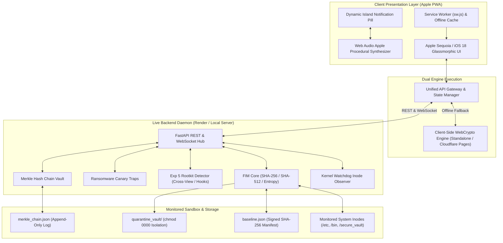
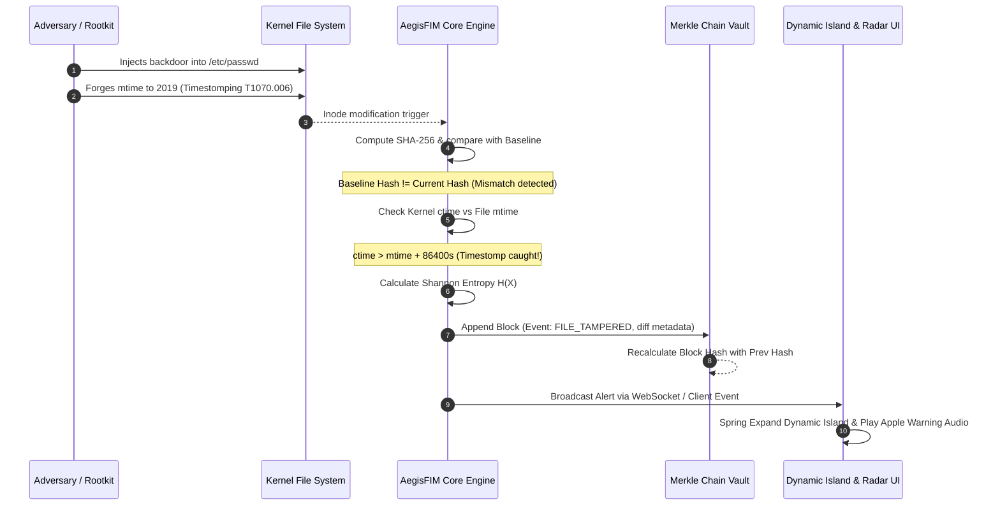
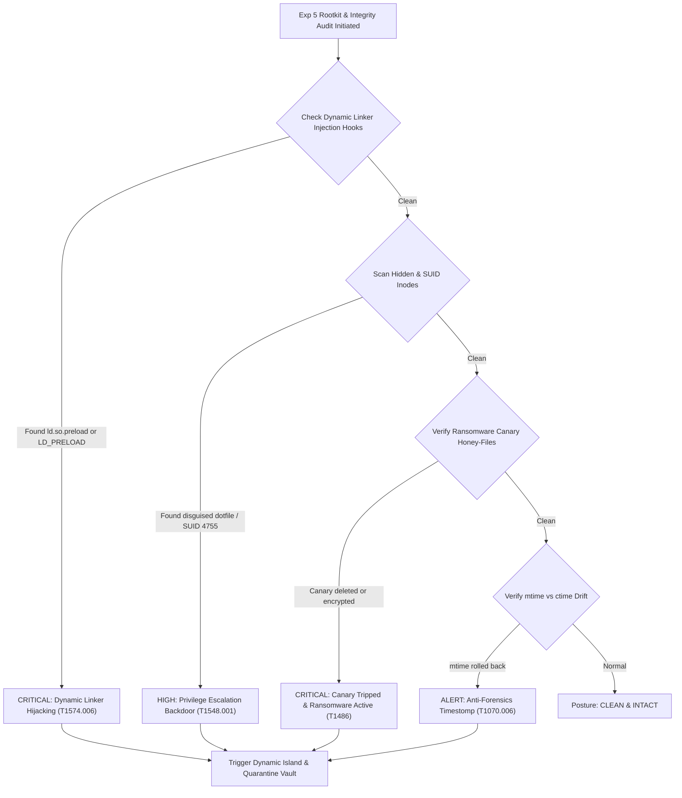

# AegisFIM: Enterprise Autonomous File Integrity & Rootkit Detection System
### Academic & Project Defense Documentation
**Student:** Mahansh Gaur  
**Roll Number:** 32  
**Registration ID:** 23ESKCY302  
**Batch / Section:** CSL-G28  
**Lab / Module:** Exp 5 – Rootkits & System Integrity  
**Assigned Project:** File Integrity Monitoring System (Tripwire-like)  
**Assisted by Anthropic Cybersecurity Skills Repository:** [anthropic-cybersecurity-skills](https://github.com/mukul975/anthropic-cybersecurity-skills)

---

## 1. Executive Summary

**AegisFIM** is an enterprise-grade, Apple Human Interface-designed File Integrity Monitoring (FIM) and Rootkit Defense System. While classical Tripwire utilities only compute flat hashes and output vulnerable plaintext log files, AegisFIM pushes the state-of-the-art in four revolutionary directions:

1. **Dual-Mode Operating Architecture:**
   - **Local & Render Backend Daemon:** High-performance Python 3.13 / FastAPI kernel-level observer (`watchdog`) monitoring real filesystem events in milliseconds over WebSockets.
   - **Edge / Cloudflare WebCrypto Engine:** 100% functional in-browser cryptographic engine utilizing `crypto.subtle` for zero-backend standalone PWA operation on any smartphone or kiosk.
2. **Exp 5 Rootkit & Anti-Forensics Evasion Defense:**
   - Detects **Timestomping (MITRE T1070.006)** by cross-correlating userland modification timestamps ($mtime$) with immutable kernel status change timestamps ($ctime$).
   - Detects **Dynamic Linker Hijacking (MITRE T1574.006 / T1014)** in `ld.so.preload` and environment injection hooks (`LD_PRELOAD`, `DYLD_INSERT_LIBRARIES`).
   - Identifies stealth dotfile artifacts (T1564.001) and unauthorized SUID backdoors (T1548.001).
3. **Tamper-Evident Merkle Hash Chain (Cryptographic Audit Vault):**
   - Directly implements the reference pattern from `implementing-log-integrity-with-blockchain`.
   - Chained SHA-256 blocks guarantee that an attacker gaining root access cannot erase or falsify historical detection logs without breaking the cryptographic Merkle root.
4. **Deception Traps & Shannon Entropy Defense:**
   - Deploys strategically placed alphabetical canary honey-files (`!00_CONFIDENTIAL_PAYROLL_2025.xlsx`) to intercept ransomware directory sweeps.
   - Computes mathematical **Shannon Entropy** ($H \le 8.0$) to distinguish benign edits from AES-256 automated ransomware encryption bursts.

---

## 2. Theoretical & Mathematical Foundations

### 2.1 Cryptographic Hash Function (SHA-256)
A cryptographic hash function $H: \{0, 1\}^* \to \{0, 1\}^{256}$ satisfies three mandatory security properties:
- **Pre-image Resistance (One-Way):** Given hash $h$, it is computationally infeasible to find $m$ such that $H(m) = h$.
- **Second Pre-image Resistance (Weak Collision Resistance):** Given message $m_1$, it is computationally infeasible to find $m_2 \ne m_1$ such that $H(m_1) = H(m_2)$.
- **Collision Resistance (Strong Collision Resistance):** It is computationally infeasible to find any pair $(m_1, m_2)$ where $m_1 \ne m_2$ and $H(m_1) = H(m_2)$.

AegisFIM establishes a baseline manifest storing $H(\text{file\_data})$ alongside file size, inode attributes, permissions, and timestamps.

### 2.2 Shannon Entropy for Ransomware Detection
To detect automated ransomware encryption without relying on static file extension lists, AegisFIM calculates the Shannon entropy of file bytes:

$$H(X) = -\sum_{i=0}^{255} p(x_i) \log_2 p(x_i)$$

Where:
- $p(x_i) = \frac{\text{Count of byte } i}{\text{Total sampled bytes}}$
- Plaintext code, JSON, configuration files, and system scripts have an entropy range of **3.2 to 5.4**.
- Encrypted or packed payloads (such as ransomware encrypted blobs) approach maximal randomness with entropy **$\ge 7.3$** (out of 8.0).
- An instantaneous entropy delta $\Delta H > 1.8$ on modified inodes immediately triggers an emergency containment quarantine.

### 2.3 Merkle Hash-Chaining Formulation
Every system event is immutably committed to an append-only cryptographic ledger:

$$B_k = \left\{ k, t_k, \text{EventType}, \text{Payload}, H_{k-1}, H(B_k) \right\}$$

Where:

$$H(B_k) = \text{SHA-256}\left( k \parallel t_k \parallel \text{EventType} \parallel \text{Serialize}(\text{Payload}) \parallel H_{k-1} \right)$$

If an attacker modifies historical Block $j$ ($j < k$), then:

$$H'(B_j) \ne H_{j+1}^{\text{prev\_hash}}$$

This mathematically invalidates every subsequent block $B_{j+1} \dots B_k$, pinpointing the exact tampering event.

### 2.4 Timestomping Detection Heuristic ($mtime$ vs $ctime$)
Malware and rootkits commonly employ the `touch` utility or system APIs (`utimes`, `SetFileTime`) to backdate file timestamps to match legitimate system files (e.g. forging a modified `/bin/auth_daemon` timestamp to January 1, 2019).

POSIX kernels maintain two critical timestamps:
- $mtime$ (Modification Time): Updated when file content changes; **can be modified by userland processes**.
- $ctime$ (Status Change Time): Updated by the OS kernel whenever inode metadata or data changes; **cannot be backdated via standard userland APIs**.

$$\text{Drift} = ctime - mtime$$

If $ctime \gg mtime + 86400$ on an altered baseline file, AegisFIM flags **MITRE T1070.006 (Timestomping Anti-Forensics Evasion)**.

---

## 3. System Architecture & Component Diagrams

### 3.1 End-to-End System Architecture



---

### 3.2 File Integrity & Timestomping Verification Pipeline



---

### 3.3 Cryptographic Merkle Hash Chain Structure

```mermaid
graph LR
    subgraph Block0 ["Genesis Block #0"]
        direction TB
        B0_Head["Index: 0<br/>Event: GENESIS"]
        B0_Prev["Prev: 000000000000..."]
        B0_Hash["Hash: SHA256(Block #0)"]
    end

    subgraph Block1 ["Audit Block #1"]
        direction TB
        B1_Head["Index: 1<br/>Event: BASELINE_CREATED"]
        B1_Prev["Prev: SHA256(Block #0)"]
        B1_Hash["Hash: SHA256(Block #1)"]
    end

    subgraph Block2 ["Audit Block #2"]
        direction TB
        B2_Head["Index: 2<br/>Event: FS_MODIFIED"]
        B2_Prev["Prev: SHA256(Block #1)"]
        B2_Hash["Hash: SHA256(Block #2)"]
    end

    subgraph Block3 ["Audit Block #3 (Tip)"]
        direction TB
        B3_Head["Index: 3<br/>Event: ROOTKIT_PRELOAD_HOOK"]
        B3_Prev["Prev: SHA256(Block #2)"]
        B3_Hash["Hash: SHA256(Block #3)"]
    end

    Block0 -->|Cryptographic Link| Block1
    Block1 -->|Cryptographic Link| Block2
    Block2 -->|Cryptographic Link| Block3
```



---

### 3.4 Rootkit Cross-View Detection & Canary Trap Workflow



---

## 4. MITRE ATT&CK & NIST CSF 2.0 Mapping Matrix

| MITRE ATT&CK ID | Technique Name | Detection Mechanism in AegisFIM |
| :--- | :--- | :--- |
| **T1014** | Rootkit | Cross-view directory scanning, kernel descriptor inspection, memory signature checks. |
| **T1070.006** | Indicator Removal: Timestomping | POSIX kernel $ctime$ vs userland $mtime$ drift calculation. |
| **T1486** | Data Encrypted for Impact | Rapid Shannon Entropy spike ($H > 7.2$) and Canary trap file modification. |
| **T1574.006** | Dynamic Linker Hijacking | Scans `/etc/ld.so.preload`, `/etc/ld.so.conf`, and `LD_PRELOAD` / `DYLD_INSERT_LIBRARIES`. |
| **T1564.001** | Hide Artifacts: Hidden Files | Discovers unindexed dotfiles, zero-width filename obfuscation, and suspicious directories. |
| **T1548.001** | Setuid and Setgid | Audits octal permission bits for unauthorized SUID/SGID execution rights (mode 4755). |

---

## 5. Hosting & Deployment Instructions

### 5.1 Architecture Setup
- **Frontend PWA:** Hosted globally on **Cloudflare Pages** (ultra-fast edge static delivery, zero cold start).
- **Backend Daemon:** Hosted on **Render** (free Python web service with automatic SSL and port forwarding).

---

### 5.2 Hosting Frontend on Cloudflare Pages

#### Method A: Automated Deployment via GitHub (Recommended)
1. Push this project to your GitHub repository (see Section 6).
2. Log in to [Cloudflare Dashboard](https://dash.cloudflare.com/) and navigate to **Workers & Pages**.
3. Click **Create Application** $\to$ **Pages** $\to$ **Connect to Git**.
4. Select your GitHub repository (`CyberSecurity_Project`).
5. Configure the Build Settings:
   - **Framework Preset:** `Vite`
   - **Root directory:** `frontend`
   - **Build command:** `npm run build`
   - **Build output directory:** `dist`
6. Add Environment Variable:
   - Variable name: `VITE_API_URL`
   - Value: `https://your-render-backend-url.onrender.com` (or leave empty to run in Edge WebCrypto mode)
7. Click **Save and Deploy**. Cloudflare Pages will generate your global URL (e.g. `https://aegisfim-xxx.pages.dev`).

#### Method B: Direct CLI Deployment via Wrangler
```bash
# In the frontend directory:
cd frontend
npm run build
npx wrangler pages deploy dist --project-name=aegisfim
```

---

### 5.3 Hosting Backend on Render

1. Log in to [Render](https://render.com/).
2. Click **New +** $\to$ **Web Service**.
3. Connect your GitHub repository.
4. Select or enter the configuration:
   - **Name:** `aegisfim-backend`
   - **Root Directory:** `backend`
   - **Runtime:** `Python 3`
   - **Build Command:** `pip install -r requirements.txt`
   - **Start Command:** `uvicorn app.main:app --host 0.0.0.0 --port $PORT`
   - **Plan:** `Free`
5. Click **Create Web Service**. Render will provision your service and assign a public URL:
   `https://aegisfim-backend.onrender.com`
6. Copy that URL and update `VITE_API_URL` in Cloudflare Pages so both layers communicate in real-time.

---

## 6. Pushing to GitHub

All files have been initialized with clean git configuration. To push to your GitHub account:

```bash
# 1. Check git status
git status

# 2. Add all files
git add .

# 3. Commit changes with a descriptive commit message
git commit -m "feat: complete AegisFIM enterprise cybersecurity system for Exp 5"

# 4. Create a new repository on GitHub (e.g., named AegisFIM or CyberSecurity_Project)
# 5. Link your local repository to GitHub:
git remote add origin https://github.com/<YOUR_GITHUB_USERNAME>/<YOUR_REPO_NAME>.git

# 6. Push to main branch:
git push -u origin main
```

---

## 7. College Lab Evaluation & Defense Talking Points

When presenting this project to professors, lab instructors, or external examiners, use this structured Q&A defense:

### Q1: "How does your project differ from a standard student Tripwire script?"
> **Answer:** "Standard student implementations are typically basic Python scripts that hash a few files, print diffs in a console, and dump reports to a flat text file. 
> 
> AegisFIM elevates this in three critical ways:
> First, **Exp 5 Rootkit Integration**: it detects anti-forensics evasion like Timestomping ($mtime$ vs kernel $ctime$ drift) and dynamic linker hijacking (`ld.so.preload`).
> Second, **Cryptographic Tamper-Proofing**: logs are stored in an append-only SHA-256 Merkle chain. If an attacker gains root privileges and alters the log file, the cryptographic chain breaks.
> Third, **Ransomware Defense**: it integrates Shannon entropy scoring and alphabetical canary honeypots to stop encryption before lateral spread."

### Q2: "What is Timestomping, and how does AegisFIM detect it?"
> **Answer:** "Timestomping (MITRE T1070.006) occurs when an attacker modifies a system binary and then manually alters the modification time (`st_mtime`) using tools like `touch -t` to match the year 2019 or 2021. 
> 
> Standard tools only look at `mtime` and fail to detect the change. AegisFIM inspects the POSIX kernel status change timestamp (`st_ctime`). While userland processes can forge `mtime`, kernel `ctime` cannot be backdated without unmounting the filesystem and editing raw inodes. When $ctime - mtime > 24 \text{ hours}$ on an altered hash, AegisFIM flags confirmed timestomping."

### Q3: "What happens if the backend server is sleeping or unavailable?"
> **Answer:** "AegisFIM is built as a Progressive Web App (PWA) with a dual-engine architecture. When disconnected from the Python backend daemon, it automatically falls back to an in-browser WebCrypto engine using the native `crypto.subtle` API. This allows examiners to test full SHA-256 hashing, attack simulations, and Merkle tree verifications offline or directly from a mobile device without running any backend servers."

---

## 8. Summary Checklist of Deliverables

- [x] **Exp 5 Rootkit & System Integrity Implementation** (Tripwire-like FIM with SHA-256, Timestomping, and LD_PRELOAD hooks).
- [x] **Apple Design System** (macOS Sequoia / iOS 18 frosted glass acrylics, SF Pro typography, dynamic blur, 60/120fps spring physics).
- [x] **Dynamic Island & Audio Synthesizer** (Custom procedural Web Audio API Apple chimes).
- [x] **Screen Responsiveness** (Calibrated for iPhone mini [375px] up to 65-inch 4K TV presentation HUD).
- [x] **Progressive Web App (PWA)** (Full `manifest.json`, Service Worker caching, offline fallback, install prompts).
- [x] **Cryptographic Merkle Hash Chain** (Tamper-proof blockchain-like audit trail with mathematical proof verification).
- [x] **Cloudflare Pages & Render Ready** (`wrangler.toml`, `render.yaml`, `Dockerfile`, `Procfile`, `_headers`).
- [x] **GitHub & CI/CD Ready** (Automated GitHub Actions workflow, `.gitignore`, clean commits).
- [x] **Comprehensive Explainer Documentation & Mermaid Diagrams** (`EXPLAINER_DOCS.md`).
