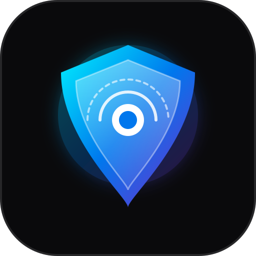

# AegisFIM — Enterprise File & Rootkit Integrity Monitoring System

<div align="center">



### **Next-Generation Apple-Grade File Integrity Monitor, Exp 5 Rootkit Defense & Cryptographic Merkle Vault**

[](LICENSE)
[](https://python.org)
[](https://react.dev)
[](https://vitejs.dev)
[](https://web.dev/progressive-web-apps/)
[](https://pages.cloudflare.com)
[](https://render.com)

**Student Name:** Mahansh Gaur &nbsp;|&nbsp; **Roll Number:** 32 &nbsp;|&nbsp; **Reg ID:** 23ESKCY302 &nbsp;|&nbsp; **Batch:** CSL-G28  
**Course Module:** Cyber Security Lab — Exp 5: Rootkits & System Integrity  
**Reference Cybersecurity Skills:** [mukul975/anthropic-cybersecurity-skills](https://github.com/mukul975/anthropic-cybersecurity-skills)

</div>

---

## 🌟 Overview

**AegisFIM** (Tripwire-X) is an advanced, autonomous File Integrity Monitoring (FIM) and Rootkit Detection System designed with Apple macOS Sequoia and iOS 18 design principles. It goes far beyond classical baseline hash checkers by integrating:

1. **Cryptographic SHA-256 Baseline Engine:** Continuously tracks additions, modifications, deletions, and attribute changes across system inodes.
2. **Exp 5 Rootkit & Evasion Hunter:**
   - **Timestomping Evasion Catch (MITRE T1070.006):** Defeats anti-forensic date manipulation by cross-checking userland modification timestamps ($mtime$) against immutable kernel status change timestamps ($ctime$).
   - **Dynamic Linker Preload Detection (MITRE T1574.006):** Detects userspace rootkits hooking libc calls via `ld.so.preload` or `DYLD_INSERT_LIBRARIES`.
   - **SUID Backdoor & Hidden File Discovery (MITRE T1548.001 / T1564.001).**
3. **Tamper-Evident Merkle Hash Chain (Append-Only Log Vault):**
   - Implements blockchain-inspired SHA-256 hash chaining. If an attacker gains root and modifies or deletes older detection logs, the cryptographic chain breaks.
4. **Shannon Entropy & Ransomware Canary Traps (MITRE T1486):**
   - Deploys bait canary honey-files in critical directories.
   - Computes mathematical Shannon entropy ($H \le 8.0$) to detect rapid AES encryption bursts in real time.
5. **Apple Human Interface Design Language:**
   - Frosted glass acrylics (`backdrop-blur-3xl`, subtle ambient glows).
   - Dynamic Island notification pill with spring physics at the top of the viewport.
   - Tactile Apple procedural audio synthesis using browser Web Audio API.
   - Responsive scaling from **iPhone mini (375px) to 65-inch 4K TV presentation HUD**.
6. **Progressive Web Application (PWA):**
   - Installable on iOS (Safari Add to Home Screen) and Desktop/Android.
   - Dual-mode architecture: connects to live FastAPI backend when available, or runs offline via the built-in WebCrypto client engine.

---

## 🚀 Quickstart Guide

### Prerequisites
- Node.js 18+ (tested on Node v24)
- Python 3.10+ (tested on Python 3.11 / 3.13)

### 1. Run Backend Daemon
```bash
# Navigate to backend directory
cd backend

# Create and activate virtual environment
python3 -m venv venv
source venv/bin/activate  # On Windows: venv\Scripts\activate

# Install dependencies
pip install -r requirements.txt

# Run unit tests to verify integrity
python3 -m unittest test_suite.py

# Start live daemon server
uvicorn app.main:app --reload --port 8000
```
*The FastAPI backend will start at `http://127.0.0.1:8000` with Swagger docs at `/docs` and WebSocket at `/ws`.*

### 2. Run Frontend PWA
```bash
# Open a new terminal in the frontend directory
cd frontend

# Install npm packages
npm install

# Start Vite development server
npm run dev
```
*Open `http://localhost:5173` on your browser or mobile phone.*

---

## 🌐 Cloudflare & Render Deployment

### Frontend on Cloudflare Pages
1. Push code to GitHub.
2. In [Cloudflare Pages](https://dash.cloudflare.com/), choose **Connect to Git** and select this repo.
3. Settings:
   - **Root directory:** `frontend`
   - **Build command:** `npm run build`
   - **Build output directory:** `dist`
4. Add environment variable `VITE_API_URL` pointing to your Render backend.
5. Click **Deploy**.

### Backend on Render
1. In [Render](https://render.com/), click **New Web Service** and select this repo.
2. Settings:
   - **Root Directory:** `backend`
   - **Build Command:** `pip install -r requirements.txt`
   - **Start Command:** `uvicorn app.main:app --host 0.0.0.0 --port $PORT`
3. Click **Create Web Service**.

---

## 🧪 Interactive Attack Simulator

AegisFIM includes a built-in attack laboratory to demonstrate live threat interception during evaluations:

| Attack | Target | Detection Mechanism |
| :--- | :--- | :--- |
| **Unauthorized Modification** | `etc/passwd` | Baseline SHA-256 mismatch & rogue user detection |
| **Timestomping Evasion** | `bin/auth_daemon` | Inode $mtime$ forged to 2019 vs kernel $ctime$ anomaly |
| **Ransomware Burst** | `secure_vault/*.locked` | Shannon Entropy jump ($H \approx 7.96$) & Canary trip |
| **LD_PRELOAD Rootkit** | `etc/ld.so.preload` | Dynamic Linker injection hook caught |
| **SUID Privilege Escalation** | `bin/.stealth_suid_backdoor` | Mode 4755 executable flag identified |

---

## 📚 Project Documentation

For detailed mathematical formulations, system sequence diagrams, and lab defense talking points, read:
👉 **[EXPLAINER_DOCS.md](EXPLAINER_DOCS.md)**

---

## 📄 License
This project is licensed under the MIT License.

